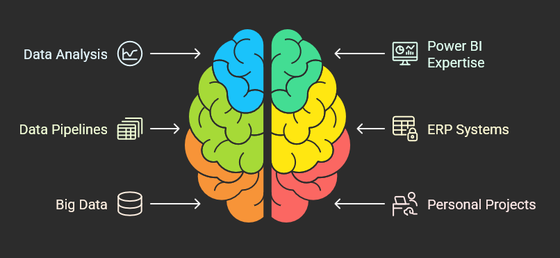

My name is Dennis Furtkevic. I have the following qualities:

- I can do Yo-Yo tricks
- I'm extremely loyal to my family
- I'm thick skinned but my mind is a sponge

What else do you need?

### How I got here

I have a degree in Animal Science from Penn State, and my first job out of school was supervising a horse facility at Select Breeders Services. From there I went to Cargill as a food safety and quality supervisor, where I ran a time series analysis on freezer operations to set quality control limits. That was the start of the data work.

I spent the next few years at Cargill building SQL queries and Power BI reports on PostgreSQL and SAP data, first for food safety and then for the Americas analytics team. In June 2025 I moved to Moog Space and Defense as a data engineer, where I build pipelines in Azure Databricks.

### Outside of work

I'm usually with my dogs, pulling shots of espresso, or working on whatever ends up on this site next. Right now that's horse show data, my sleep, and a home server that never stops needing something.

Check out my [resume](/resume/) while you're here.
