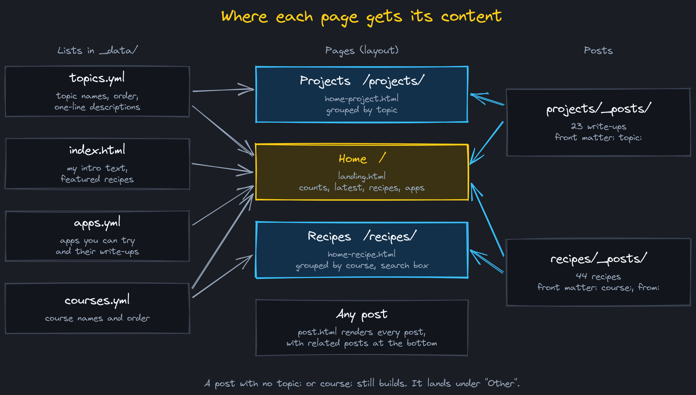
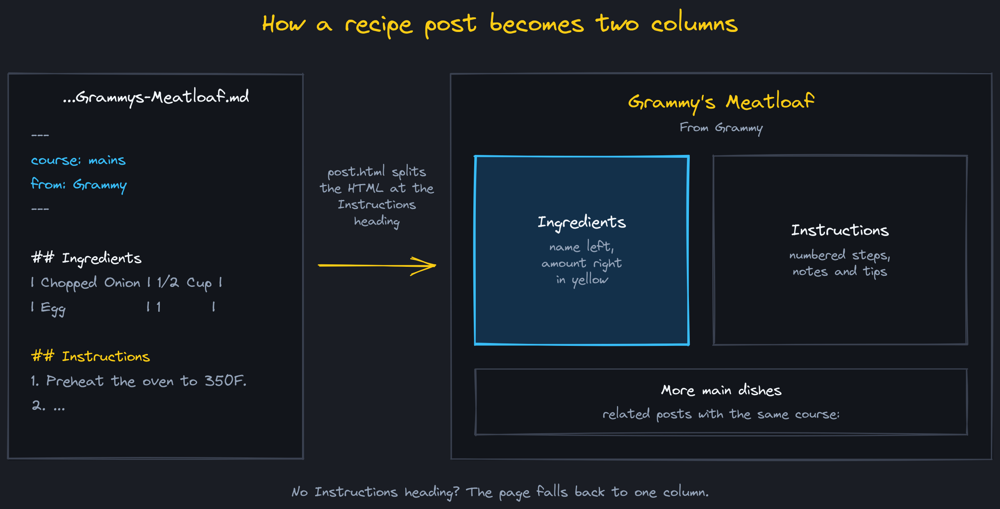
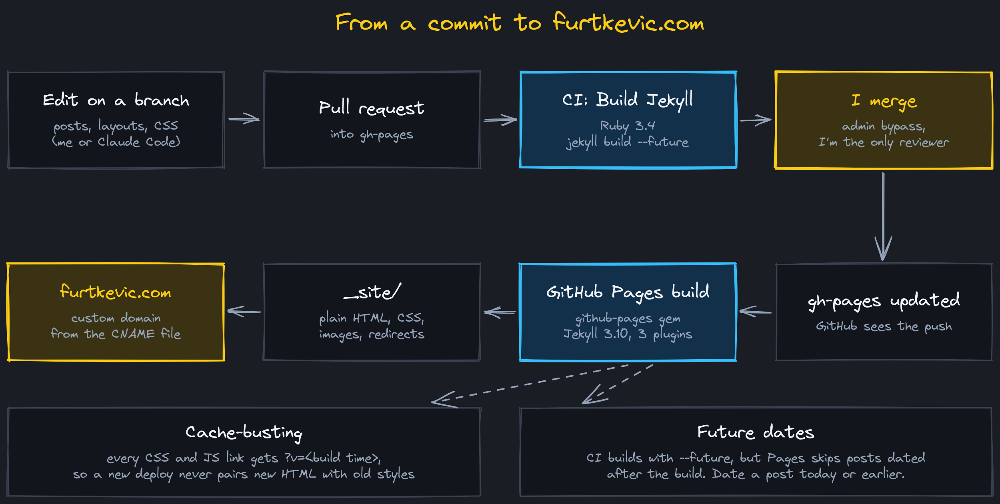

This site started as a stock copy of [Beautiful Jekyll](https://beautifuljekyll.com), the theme by Dean Attali. It still runs on it, but most of what you see now is mine: a custom home page, a Projects page grouped by topic, a Recipes page grouped by course, and about 2,300 lines of CSS on top of the theme. This post covers what I changed and how a change gets from my repo to furtkevic.com.

The source is in my GitHub repo `DovarFalcone/dovarfalcone.github.io`. GitHub Pages builds it from the `gh-pages` branch.

## Where each page gets its content

Beautiful Jekyll gives you one paginated feed of every post. With horse show data, sleep data, home lab notes, and 44 recipes all in that one feed, it was hard to find anything.

So the pages are now built from two folders of posts and a few small lists in `_data/`:

{: .mx-auto.d-block :}

- **Home** (`_layouts/landing.html`). The intro text comes from `index.html`. Below it are counts per topic and course, the five latest projects, four featured recipes picked by slug in `index.html`, and the apps from `_data/apps.yml`, each with a link to its write-up.
- **Projects** (`_layouts/home-project.html`). Every project post sets `topic:` in its front matter, and the page groups posts in the order of `_data/topics.yml`. A topic can set `order: oldest`, which I use for the sleep data series so Part 1 comes first.
- **Recipes** (`_layouts/home-recipe.html`). Every recipe sets `course:` and `from:`. The page groups them by course in the order of `_data/courses.yml` and has a search box that filters by recipe name or by the family member it came from. Type "Grammy" and you get Grammy's recipes.

A post with no `topic:` or `course:` still builds. It shows up under "Other" at the bottom of the page.

Adding a new topic is one entry in `topics.yml`. I don't have to touch a layout.

## Recipe pages

Each recipe is a Markdown file with an ingredients table and a numbered list of steps. I wanted the ingredients beside the steps, like a cookbook, without adding HTML to 44 files.

{: .mx-auto.d-block :}

`_layouts/post.html` takes the rendered HTML of a recipe and splits it on the `<h2 id="instructions">` heading. Everything before it goes in the left column, everything after goes in the right. If a recipe doesn't have that heading, it stays in one column. The ingredients table is styled as a list, name on the left and amount on the right in yellow.

Two other things happen on every post:

- **Related posts.** Projects show up to four more posts from the same topic, and recipes show up to four from the same course.
- **Duplicate titles.** A lot of my older posts start with a `#` heading that repeats the title, so the title showed twice. `_includes/strip-leading-title.html` drops that first heading when it matches the post title and leaves it alone when it doesn't.

## Styles

Everything visual lives in `assets/css/custom-styles.css`. It loads after the theme's `beautifuljekyll.css` and overrides it, so I never edit the theme's CSS. Colors, fonts, and spacing are variables at the top of the file: slate backgrounds (`#1A1D24` and `#12151B`), yellow `#FACC15` for titles, and blue `#38BDF8` for links. The font is Inter, with JetBrains Mono for code.

Code blocks gave me trouble. The theme ships a light code theme, and its `.highlight pre` rule was more specific than my dark one, so code blocks came out as light gray boxes in the middle of a dark page. I fixed the colors and added `scripts/check-code-contrast.py`, which checks every code token color against the dark background and fails if any are under a 4.5:1 contrast ratio.

The navigation bar and the footer come from `navbar-links` and `footer-links` in `_config.yml`, so adding a page to the menu is a config change.

## Redirects

I've renamed and merged posts a few times, and I don't want old links to break. The `jekyll-redirect-from` plugin handles it. A post lists its old URLs under `redirect_from:` and the build writes a small page at each old URL that forwards to the new one:

```yaml
redirect_from:
  - /2026-07-29-hermes-ai-lab/
  - /2026-10-06-agent-fleet-kanban/
  - /2026-10-06-agent-memory-two-stores/
```

That one is from [My AI Setup](/2026-10-15-my-ai-setup/), which replaced three older posts. The old paginated feed pages, `/page2/` through `/page14/`, now forward to `/projects/`. The forwarding page uses my own `_layouts/redirect.html` so it matches the site instead of showing a bare white page.

Links that don't exist at all get the 404 page, with Officer Barbrady telling you to move along.

## From a commit to furtkevic.com

{: .mx-auto.d-block :}

1. **Edit on a branch.** Most changes now come from Claude Code working on a `claude/` branch.
2. **Pull request into `gh-pages`.** The branch rule requires one approving review.
3. **CI runs.** The "Build Jekyll" GitHub Actions workflow runs on every push and pull request. It sets up Ruby 3.4 and runs `bundle exec jekyll build --future`. If the build breaks, I know before anything merges.
4. **I merge.** I'm the only collaborator on the repo, so I merge with the admin bypass checkbox instead of approving my own pull request.
5. **GitHub Pages builds.** The push to `gh-pages` starts GitHub's own "pages build and deployment" job. It builds the site with the `github-pages` gem, which pins Jekyll 3.10 and only allows certain plugins. I use three: `jekyll-paginate`, `jekyll-sitemap`, and `jekyll-redirect-from`.
6. **The site goes live.** The output in `_site/` is plain HTML, CSS, and images. The `CNAME` file in the repo tells GitHub Pages to serve it on furtkevic.com.

The `Gemfile` pins the same `github-pages` gem, so a local build matches what GitHub runs. Ruby 3.4 dropped `base64`, `bigdecimal`, and `erb` from the standard library, and Jekyll 3 still needs them, so the `Gemfile` adds them back.

Two problems I've had to plan around.

**Stale styles after a deploy.** Browsers cache CSS, so after a redesign a visitor could get the new HTML with the old styles. Every local CSS and JS link now ends in `?v=` plus the build time (`{{ site.time | date: '%s' }}`), so each deploy has new URLs and browsers fetch fresh files.

**Posts that don't show up.** GitHub Pages skips any post dated after the build. CI builds with `--future`, so it won't catch that. I date every post today or earlier.

To build it locally:

```bash
bundle install
bundle exec jekyll serve
```

The site is then at `http://localhost:4000`.

The diagrams in this post were drawn in Excalidraw. The `.excalidraw` source files are in the repo next to the images in `projects/assets/images/site/` if you want to open them.
