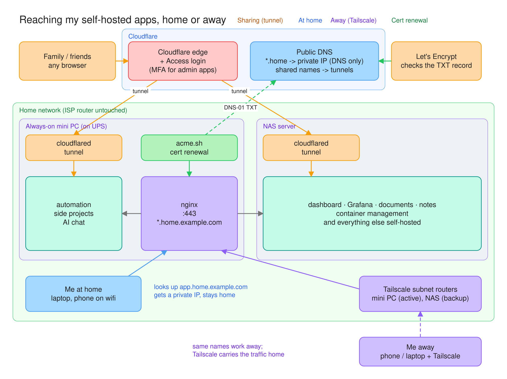
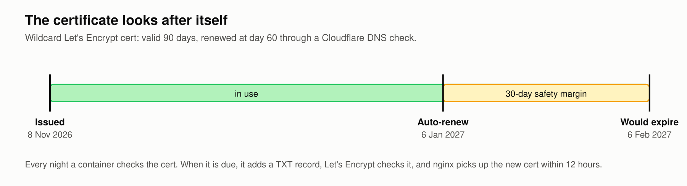
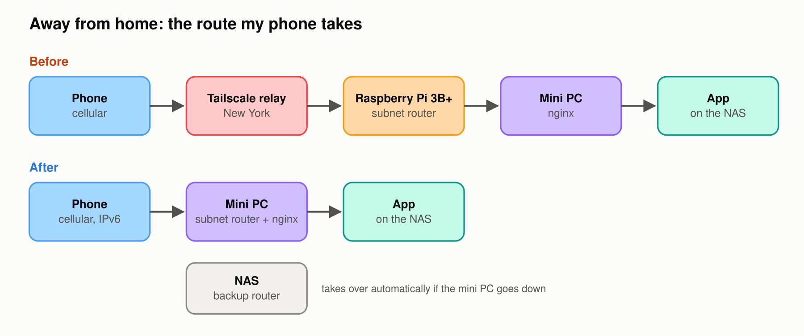
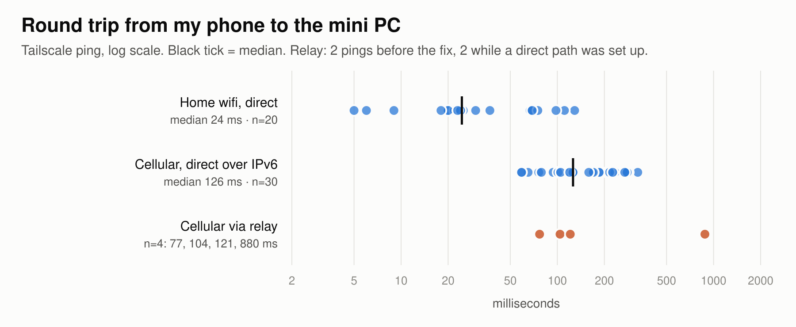
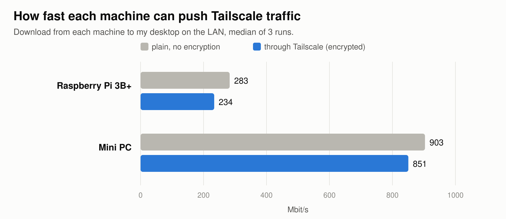
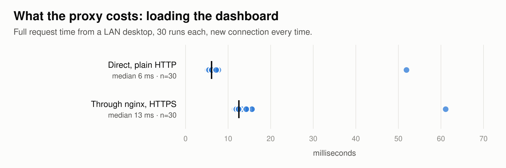

## The Problem

I had about 30 self-hosted web apps. I reached them by typing a private IP and a port number, and nearly every app had its own port. No names, no HTTPS. The browser put a "Not secure" warning in front of all of them, which was an accurate description of the setup.

That worked as long as I remembered which port was which.

What I wanted was simple: a real name for each app, and HTTPS. Both had to work at home and away from home. My ISP's router cannot run local DNS, so the obvious route of pointing names at the mini PC from the router was out before I started.

One piece already existed. The apps that family and friends use sit behind a Cloudflare Tunnel and Cloudflare Access, and the admin ones require MFA. That stays exactly as it is. This post is about the second path, the one I use myself.

## Names at Home

The first piece is one wildcard DNS record. `*.home.example.com` points at the mini PC's private IP. I set it to "DNS only" so Cloudflare does not proxy it. That single record covers every name I will ever use under it, so adding an app never means touching DNS.

The odd part is that public DNS is handing out a private IP. At home, that answer sends the browser straight to the mini PC over the local network. From the internet the same answer leads nowhere, because a private address is not routable. No router change was needed for any of this.

There is one failure mode I checked for. Some routers refuse DNS answers that point back into the local network, since that pattern shows up in DNS rebinding attacks. I loaded one of the names from my phone while on home wifi and it resolved fine. If a router does block it, pointing that device's DNS at a public resolver like `1.1.1.1` gets around it without touching the router.

On the mini PC, nginx does the rest. There is one line per app in a map: the name on the left, the backend on the right. So far that's 31 apps. Adding a name costs one line and a reload.

Three apps needed something extra. The dashboard only accepts hostnames that are on its own allow-list, so its name had to be added there. The document manager refused logins until I added the new address as a trusted origin, which is a CSRF check doing its job. The NAS's own web UI only answers to its IP, so for that one backend nginx sends the IP as the Host header.

{: .mx-auto.d-block :}

## Getting HTTPS

One wildcard certificate from Let's Encrypt covers all of the home names. I used the DNS-01 challenge, where you prove you control the domain by adding a TXT record, rather than serving a file from a web server. That matters here, because nothing has to be reachable from the internet to get a certificate.

There is a side effect I like. Certificate transparency logs only show `*.home.example.com`, not the name of each app. The list of things I run is not published.

acme.sh runs in a container and renews the certificate. nginx reloads every 12 hours, which is more often than needed, so a renewal gets picked up without me doing anything. The certificate is good for 90 days and renews at 60. The first one was issued on 8 November 2026, and the next renewal is 6 January 2027.

The Cloudflare API token that acme.sh uses can only edit DNS on that one zone. I created it on my phone and pasted it into a one-time page on the home network. The page saved it to the mini PC and shut itself off. The token never went through a chat window or Discord, which was the part I cared about.

{: .mx-auto.d-block :}

## Away From Home

The same names away from home come from Tailscale. A subnet router advertises the home network to my devices, so `dashboard.home.example.com` resolves and routes the same way whether I am at my desk or on cellular.

It worked, but it felt slow, and there were two reasons.

The first was the path. The phone was going through a Tailscale relay server in New York instead of connecting directly. The second was the machine doing the work: the active subnet router was a Raspberry Pi 3B+, and its CPU was handling all the encryption for the tunnel. A Pi 3B+ is fine for plenty of things. This was not one of them.

When several machines advertise the same network, Tailscale picks one as the active router. It kept picking the Pi. I removed the route from the Pi and the NAS became active. I re-added the Pi as a backup and it became active again.

The fix was to install Tailscale on the mini PC. It is on the UPS, it already runs nginx, and it has a real CPU. It became the active router, the NAS is the automatic backup, and the Pi is now only an exit node.

{: .mx-auto.d-block :}

On cellular the phone connects directly over IPv6, so there is no relay and no port forward. The one case where a port forward might still help is an IPv4-only network, like some hotel wifi, and even then it is a single port for Tailscale's 41641.

The numbers, from Tailscale ping: at home on wifi, direct, median 24 ms over 20 pings, with a spread of 5 to 129 ms because the phone's wifi power saving gets in the way. On cellular, direct, median 126 ms over 30 pings. Through the relay: 104 and 880 ms from my desktop before the fix, and 77 and 121 ms from the phone while it was still setting up a direct path.

The relay was not always slower. On latency alone it can win, and on a cellular network that is mostly the cell network talking. The reason to fix the path anyway is what travels with the relay: it caps bandwidth, it occasionally hands you a spike to 880 ms, and with the Pi as the router every byte was also going through a 3B+.

{: .mx-auto.d-block :}

So I measured bandwidth. A 150 MB download from each machine to my desktop on the LAN, median of 3 runs each: on the Pi, 283 Mbit/s plain and 234 through Tailscale. On the mini PC, 903 plain and 851 through Tailscale. The mini PC moves encrypted Tailscale traffic about 3.6x faster.

Even that flatters the Pi. As a subnet router it passes every byte in and out through the same network port, so real throughput through it was lower than this test shows.

{: .mx-auto.d-block :}

## What It Costs

I expected the extra hop through nginx to be noticeable, so I measured it. Loading the dashboard from a desktop on the LAN, 30 times, with a new connection every time: direct over plain HTTP, median 6 ms. Through nginx with HTTPS, median 13 ms. Most of the difference is the TLS handshake, at a median of about 6 ms.

The browser reuses the connection, so that cost is paid once, not on every request. In normal browsing I can't tell it's there.

{: .mx-auto.d-block :}

## Is It Safe

Nothing new is reachable from the internet. No ports were opened on the router. The home names resolve to a private IP and lead nowhere from outside. Away from home the only way in is the tailnet, and the tailnet has one user, me.

nginx does not log anyone in. It is a proxy, not an auth layer, and I do not treat it as one. Anyone on the home network or on the tailnet can reach any of the apps, so every app needs its own login.

While reviewing what listens on the mini PC, I found a container-management API listening on the whole network with no password. It had been like that for about six months. It is now bound to localhost. The lesson is to check what is listening on all interfaces, not only the ones you remember setting up.

Claude Code and my Hermes agents did the hands-on work here; I approved the root-level steps from Discord on my phone. That setup has its own post, [my AI setup](/2026-10-15-my-ai-setup/).

## Adding an App

Adding an app now takes three steps. Make sure it has its own login. Add one line to the nginx map and reload. If someone outside the tailnet needs it, publish it through the tunnel and Access instead, which is a different path with its own rules.

The DNS and the certificate do not come up at all. The wildcard record covers the name and the wildcard certificate covers it, so the two pieces that took the most work are the two I no longer touch. Most of the time the slow part is picking a name.
